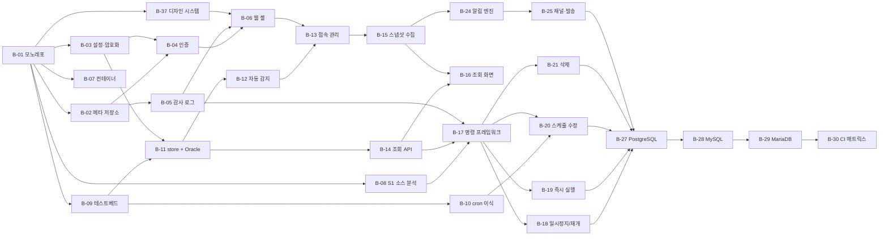

# quartz-admin 백로그

| 항목 | 내용 |
| --- | --- |
| 문서 버전 | v0.39 |
| 작성일 | 2026-11-05 |
| 상위 문서 | PRD v0.5(`docs/PRD.md`), TRD v0.33(`docs/TRD.md`) |
| 작업 단위 | 기능 단위. 작업 하나는 API, 화면, 테스트를 모두 포함한 하나의 PR |
| 추정 | 하지 않음. 순서와 의존성만 관리 |
| 저장소·CI | GitHub(`courage-work/quartz-admin`, 공개), GitHub Actions |

### 변경 이력

작업 상태(§3 표의 상태 열) 변경은 이력에 남기지 않습니다. 각 작업의 PR이 기록입니다.

| 버전 | 날짜 | 내용 |
| --- | --- | --- |
| v0.1 | 2026-11-05 | 초안: 마일스톤 M0~M5, 작업 36개, Oracle 수직 슬라이스 우선 |
| v0.2 | 2026-11-05 | B-02 PR(#2): B-10 의존성을 B-01에서 B-09로 수정, B-07에 배포 주의점 추가 |
| v0.3 | 2026-11-05 | B-08 PR(#3): B-17~B-24 완료 기준에 TRD 부록 A 케이스 연결, 상위 문서 버전 갱신 |
| v0.4 | 2026-11-06 | 변경 이력 추가, B-01 저장소 문구를 실제(공개 저장소)에 맞춤, §1.1 상태 변경 시점과 브랜치 자동 삭제 반영 |
| v0.5 | 2026-11-06 | B-04 PR: 상위 문서를 TRD v0.3으로 갱신, B-06 범위에 화면 서빙용 CSP 조정 추가(TRD §4.3) |
| v0.6 | 2026-11-06 | B-37(디자인 시스템) 추가: B-06의 shadcn/ui 기본 컴포넌트 범위를 B-37로 옮기고 B-06 의존에 B-37 추가, NFR-UX-01·02 추적에 B-37 추가, 상위 문서를 TRD v0.4로 갱신 |
| v0.7 | 2026-11-06 | B-05 PR: 상위 문서를 TRD v0.5로 갱신, 문서 버전 표기를 변경 이력에 맞춤(v0.6 누락분) |
| v0.8 | 2026-11-06 | B-06 PR: 상위 문서를 TRD v0.6으로 갱신 |
| v0.9 | 2026-11-06 | B-07 PR: 상위 문서를 TRD v0.7로 갱신 |
| v0.10 | 2026-11-06 | B-10 PR: 상위 문서를 TRD v0.8로 갱신 |
| v0.11 | 2026-11-06 | B-11 PR: 상위 문서를 TRD v0.9로 갱신 |
| v0.12 | 2026-11-06 | MVP 기능 개발 동안 PR CI 중지: §1.1 3단계와 §1.2 첫 항목을 로컬 검사로 바꿈, 상위 문서를 TRD v0.10으로 갱신 |
| v0.13 | 2026-11-06 | B-12: 상위 문서를 TRD v0.11로 갱신 |
| v0.14 | 2026-11-06 | B-13: 상위 문서를 TRD v0.12로 갱신 |
| v0.15 | 2026-11-06 | B-14: 상위 문서를 TRD v0.13으로 갱신 |
| v0.16 | 2026-11-06 | B-15: 상위 문서를 TRD v0.14로 갱신 |
| v0.17 | 2026-11-07 | B-16: 상위 문서를 TRD v0.15로 갱신 |
| v0.18 | 2026-11-07 | B-16 UX 점검: 남은 항목(터치 영역, 목록 페이지네이션, `/` 단축키, 대시보드 구성)을 B-38로 추가, NFR-UX 추적에 B-38 추가 |
| v0.19 | 2026-11-07 | B-39(화면 시각 정비) 추가. B-38의 대시보드 구성(요약 띠)은 B-39에서 처리하고 B-38 범위에서 뺌 |
| v0.21 | 2026-11-09 | B-40(이동과 돌아가기) 추가: 목록 상태를 주소에 두고 상세 화면에 돌아가기 버튼, 밑줄 링크를 줄 링크·링크 색으로 바꿈, 표 줄 높이 통일, 화면 폼을 상세와 같은 배치로, 빈 칸은 저장할 때 검사. NFR-UX 추적에 B-40 추가 |
| v0.20 | 2026-11-08 | B-38: VectorLab UX 점검(B-39 후속)에서 나온 정책 항목(모달→화면·시트, 오류 정보 복사, 폼 안전장치, 화면 폭 기준 3개, `.ux-profile.md`)을 범위에 더함 |
| v0.22 | 2026-11-09 | B-17: 프레임워크를 끝까지 검증하도록 첫 명령 `pauseTrigger`(트리거 줄 메뉴 포함)를 B-18에서 B-17로 옮김. 부록 A.8 X-05(그룹 명령 반복)는 `pauseTriggerGroup`이 필요해 B-18 완료 기준으로 옮김. 상위 문서를 TRD v0.16으로 갱신 |
| v0.23 | 2026-11-09 | 한 프로세스 개발 모드(`pnpm dev:hmr`) 추가에 따라 상위 문서를 TRD v0.17로 갱신 |
| v0.24 | 2026-11-10 | B-18: 상위 문서를 TRD v0.18로 갱신 |
| v0.25 | 2026-11-10 | B-19: 상위 문서를 TRD v0.19로 갱신 |
| v0.26 | 2026-11-10 | B-20: 상위 문서를 TRD v0.20으로 갱신 |
| v0.27 | 2026-11-10 | B-20 완료 기준을 집힌 트리거 수정 경합(TRD §7.2·§7.6)에 맞춤: 옛 발화 직후로 고치면 거부. 상위 문서를 TRD v0.21로 갱신 |
| v0.28 | 2026-11-10 | B-21: 상위 문서를 TRD v0.22로 갱신 |
| v0.29 | 2026-11-10 | B-24: 상위 문서를 TRD v0.23으로 갱신 |
| v0.30 | 2026-11-11 | B-25: 상위 문서를 TRD v0.24로 갱신 |
| v0.31 | 2026-11-11 | B-27: 상위 문서를 TRD v0.25로 갱신 |
| v0.32 | 2026-11-11 | B-28: 상위 문서를 TRD v0.26으로 갱신, B-28 범위의 조회 제한을 세션 `max_execution_time`으로 |
| v0.33 | 2026-11-11 | B-29: 상위 문서를 TRD v0.27로 갱신 |
| v0.34 | 2026-11-11 | B-28·B-29 후속(main CI X-05 실패): 상위 문서를 TRD v0.28로 갱신. MySQL 계열 misfire 경합의 노드 권장 설정과 감지 경고 |
| v0.35 | 2026-11-11 | B-30 완료. 상위 문서를 TRD v0.29로 갱신. §1 규칙 3: PR에서 최신 버전 통합 테스트(4조합)가 돌고 전체 매트릭스는 main 머지 뒤에 돈다 |
| v0.36 | 2026-11-12 | B-31 완료. 상위 문서를 TRD v0.30으로 갱신(§12.4 성능·규모 검증 결과) |
| v0.37 | 2026-11-12 | B-32 완료. 상위 문서를 TRD v0.31로 갱신(§4.5 보안 점검 결과). B-36 범위에 배포 보안 설정(나가는 연결 제한, `QA_TRUST_PROXY`) 추가 |
| v0.38 | 2026-11-12 | B-35 점검 도구와 점검표 준비(`check:oracle`, `docs/oracle-legacy-check.md`). 상위 문서를 TRD v0.32로 갱신. 사내 19c 점검은 사용자가 사내망에서 수행 |
| v0.39 | 2026-11-12 | B-22 완료. 상위 문서를 TRD v0.33으로 갱신(§7.1 일괄 제어) |

---

## 1. 진행 규칙

### 1.1 작업 흐름

1. 의존 작업이 모두 `완료`인 작업 중에서 우선순위가 높고 ID가 작은 것부터 시작합니다.
2. 작업마다 브랜치를 만듭니다. 이름은 `feat/B-12-auto-detect` 형식입니다.
3. 작업 하나를 PR 하나로 올리고 머지합니다. 올리기 전에 로컬에서 §1.2의 검사를 돌립니다. PR에서는 검사와 각 DB 최신 버전 × Quartz 2.5.2 통합 테스트(4조합)가 돌고, 16조합 전체 매트릭스는 main에 머지된 뒤와 Actions 화면에서 직접 실행할 때 돕니다(TRD §12.2). 브랜치 보호의 필수 검사는 MVP 이후 CI/CD를 정리할 때 켭니다.
4. 구현하다가 PRD나 TRD와 다른 결정을 하게 되면 같은 PR에서 해당 문서를 고칩니다.
5. 같은 PR 안에서 §3 개요 표의 해당 작업 상태를 `완료`로 바꿉니다. 머지되면 그대로 반영됩니다.
6. 상태 외에 백로그 내용을 고치면 위 변경 이력에 한 줄을 추가합니다.

PR을 머지하면 GitHub이 원격 브랜치를 자동으로 지웁니다. 로컬 브랜치는 `git fetch --prune` 후 `git branch -d`로 정리합니다.

상태 값은 `대기`, `진행`, `완료`, `보류` 네 가지입니다.

### 1.2 공통 완료 정의 (DoD)

모든 작업에 적용합니다. 각 작업의 완료 기준은 이 목록에 더해지는 조건입니다.

- [ ] lint, typecheck, 단위 테스트가 통과한다(MVP 동안은 로컬에서 확인, 이후 PR CI)
- [ ] 새로 만든 로직에 단위 테스트가 있다. 대상 DB를 다루는 코드는 Testcontainers 통합 테스트가 있다
- [ ] 상태를 바꾸는 API는 감사 로그를 남긴다(B-05 이후)
- [ ] 로그와 API 응답에 비밀값이 없다
- [ ] 화면 문구는 한국어다
- [ ] 관련 문서(PRD, TRD, README)가 실제 구현과 일치한다

### 1.3 AI 작업 지시 템플릿

```
docs/BACKLOG.md의 B-xx를 구현해줘.
- 범위와 완료 기준은 B-xx 항목을 따르고, 참조된 PRD/TRD 절을 먼저 읽어.
- 브랜치 feat/B-xx-<slug>에서 작업하고, 공통 완료 정의(§1.2)를 모두 확인한 뒤 PR을 만들어.
- 범위 밖 작업이 필요하면 구현하지 말고 백로그 추가 항목으로 제안해.
```

## 2. 마일스톤

PRD §12의 마일스톤을 **Oracle 수직 슬라이스 우선** 순서로 다시 배치했습니다. Oracle 하나로 접속부터 알림까지 끝까지 동작시킨 뒤 나머지 3종 DB를 추가합니다. 가장 까다로운 Oracle을 먼저 해서 `QuartzDialect` 인터페이스가 실제로 충분한지 일찍 확인하려는 것입니다.

| 마일스톤 | 목표 | 완료 조건 |
| --- | --- | --- |
| **M0 기반** | 로그인할 수 있는 빈 앱을 컨테이너로 배포 | 로그인, 사용자 관리, 감사 로그 조회 화면이 Docker Compose로 동작. CI 통과 |
| **M1 Oracle 조회** | Oracle Quartz 클러스터를 등록하고 조회 | Oracle Free 23의 테스트베드 클러스터를 자동 감지로 등록하고, 대시보드와 잡/트리거/노드/실행 중 화면에서 확인 |
| **M2 Oracle 제어** | Oracle 클러스터를 안전하게 제어 | P0 제어 기능이 모두 동작. 실제 2노드 Quartz 클러스터에서 통합 테스트와 차등 테스트가 통과 |
| **M3 알림** | 이상 징후 알림 | 6종 규칙이 Oracle 클러스터에서 발생, 해소되고 인앱/Slack/이메일로 발송됨 |
| **M4 DB 확장** | PostgreSQL, MySQL, MariaDB 지원 | 4종 DB × 최소·최신 버전 × Quartz 2.3.2/2.5.x 매트릭스가 CI에서 통과 |
| **M5 출시** | 사내 운영 투입 | 성능·보안 점검 통과, 사내 Oracle 19c 수동 점검, 운영 문서 완비, 파일럿 스케줄러 등록 |



M1의 B-08과 B-09는 서로 의존하지 않아 M0 작업과 함께 AI 세션 여러 개로 병렬 진행할 수 있습니다. B-10은 B-09 테스트베드의 `cron-vectors`로 검증 벡터를 만들므로 B-09 다음입니다. M2와 M3도 B-15 이후에는 병렬로 진행할 수 있습니다.

## 3. 작업 개요

| ID | 작업 | 마일스톤 | 우선순위 | 의존 | 상태 |
| --- | --- | --- | --- | --- | --- |
| B-01 | 모노레포와 개발 도구 체인 | M0 | P0 | - | 완료 |
| B-02 | 메타데이터 저장소(SQLite) | M0 | P0 | B-01 | 완료 |
| B-03 | 설정 로딩과 자격증명 암호화 | M0 | P0 | B-01 | 완료 |
| B-04 | 인증, 세션, 사용자 관리 API | M0 | P0 | B-02, B-03 | 완료 |
| B-05 | 감사 로그 기반 | M0 | P0 | B-02 | 완료 |
| B-06 | 웹 앱 셸과 관리 화면 | M0 | P0 | B-04, B-05, B-37 | 완료 |
| B-07 | 컨테이너, 로깅, 헬스체크 | M0 | P0 | B-01 | 완료 |
| B-08 | [스파이크 S1] Quartz 소스 분석과 TRD 확정 | M1 | P0 | B-01 | 완료 |
| B-09 | [스파이크 S2] quartz-testbed와 통합 테스트 하네스(Oracle) | M1 | P0 | B-01 | 완료 |
| B-10 | [스파이크 S4] cron과 트리거 계산 이식(`@qa/core`) | M1 | P0 | B-09 | 완료 |
| B-11 | [스파이크 S3] `@qa/store` 기반과 Oracle 어댑터 | M1 | P0 | B-03, B-09 | 완료 |
| B-12 | 자동 감지(Oracle) | M1 | P0 | B-11 | 완료 |
| B-13 | 접속·스케줄러 관리 | M1 | P0 | B-06, B-12 | 완료 |
| B-14 | 조회 API(Oracle) | M1 | P0 | B-11 | 완료 |
| B-15 | 감시 루프와 스냅샷 수집 | M1 | P0 | B-13 | 완료 |
| B-16 | 대시보드와 조회 화면 | M1 | P0 | B-14, B-15 | 완료 |
| B-17 | 제어 명령 프레임워크 | M2 | P0 | B-05, B-08, B-14 | 완료 |
| B-18 | 일시정지/재개(트리거, 잡, 그룹) | M2 | P0 | B-17 | 완료 |
| B-19 | 즉시 실행 | M2 | P0 | B-17 | 완료 |
| B-20 | 스케줄 수정(CRON, SIMPLE) | M2 | P0 | B-10, B-17 | 완료 |
| B-21 | 트리거·잡 삭제 | M2 | P0 | B-17 | 완료 |
| B-22 | 일괄 제어 | M2 | P1 | B-18 | 완료 |
| B-23 | 스케줄러 전체 일시정지/재개 | M2 | P1 | B-18 | 대기 |
| B-24 | 알림 규칙 엔진 | M3 | P0 | B-15 | 완료 |
| B-25 | 알림 채널과 발송 | M3 | P0 | B-24 | 완료 |
| B-26 | 알림 음소거 | M3 | P1 | B-25 | 대기 |
| B-27 | PostgreSQL 지원 | M4 | P0 | B-18, B-19, B-20, B-21, B-25 | 완료 |
| B-28 | MySQL 지원 | M4 | P0 | B-27 | 완료 |
| B-29 | MariaDB 지원 | M4 | P0 | B-28 | 완료 |
| B-30 | CI DB 매트릭스 완성 | M4 | P0 | B-29 | 완료 |
| B-31 | 성능·규모 검증 | M5 | P0 | B-25, B-30 | 완료 |
| B-32 | 보안 점검 | M5 | P0 | B-25, B-30 | 완료 |
| B-33 | E2E 테스트 | M5 | P1 | B-25 | 대기 |
| B-34 | 감사 로그 CSV 내보내기 | M5 | P1 | B-05 | 대기 |
| B-35 | 사내 Oracle 구버전 수동 점검 | M5 | P0 | B-21, B-25 | 진행 |
| B-36 | 운영 문서와 파일럿 출시 | M5 | P0 | B-31, B-32, B-35 | 대기 |
| B-37 | 디자인 시스템(테마, 토큰, 기본 컴포넌트, 린트) | M0 | P0 | B-01 | 완료 |
| B-38 | UX 기준 정비(터치 영역, 목록 검색·페이지네이션, 검색 단축키, 오버레이, 폼 안전장치) | M5 | P1 | B-16 | 완료 |
| B-39 | 화면 시각 정비(면 계층, 브랜드, 대시보드 요약 띠, 상세 지표) | M1 | P1 | B-16 | 완료 |
| B-40 | 이동과 돌아가기(목록 상태 유지, 돌아가기 버튼, 링크 표현) | M1 | P1 | B-39 | 완료 |

후속(P2, 이 백로그 범위 밖): FR-CTL-13(CAL_INT, DAILY_I 수정), Phase 2(실행 이력, 실패 감지), Phase 3(SSO, 역할)

---

## 4. 작업 상세

### M0 기반

#### B-01 모노레포와 개발 도구 체인

- **참조**: TRD §1, §2.1, §12.2
- **범위**
  - `git init`과 GitHub 저장소 연결(`courage-work/quartz-admin`, 공개), 기본 브랜치 보호(CI `verify` 통과 필수, 관리자 포함)
  - pnpm workspace, Turborepo, TypeScript strict, ESLint, Prettier, Vitest 공통 설정
  - 빈 패키지 골격: `apps/web`(Next.js, `output: 'export'`), `apps/api`(NestJS 12), `packages/shared`, `packages/core`, `packages/store`
  - GitHub Actions: lint, typecheck, unit test, build
  - `.nvmrc`(Node 24), `NOTICE`(Quartz 이식 고지용), `README` 골격
- **완료 기준**
  - `pnpm install && pnpm build && pnpm test`가 처음 받은 클론에서 통과한다
  - PR을 올리면 CI가 자동으로 돌고, 실패하면 머지가 막힌다

#### B-02 메타데이터 저장소 (SQLite)

- **참조**: TRD §3, NFR-REL-03, NFR-REL-04, NFR-OPS-04
- **범위**
  - better-sqlite3와 Drizzle 연결, PRAGMA 설정
  - TRD §3.2의 전체 스키마와 drizzle-kit 마이그레이션, 기동 시 자동 적용
  - 단일 인스턴스 락(하트비트 10초, 30초 안에 다른 인스턴스가 있으면 기동 거부)
  - 일일 온라인 백업(7개 보관), `backup` CLI
  - 보존 정책 작업 실행기(대상별 정리 함수는 각 작업에서 등록)
- **완료 기준**
  - 빈 `/data`에서 기동하면 스키마가 만들어지고, 다시 기동해도 마이그레이션이 중복 적용되지 않는다
  - 같은 데이터 디렉터리로 두 번째 프로세스를 띄우면 명확한 오류와 함께 종료된다
  - 백업 파일로 복원해 기동할 수 있다

#### B-03 설정 로딩과 자격증명 암호화

- **참조**: TRD §4.1, §11.2, NFR-SEC-01, FR-CON-06
- **범위**
  - 환경변수 zod 검증. 필수값이 없거나 형식이 틀리면 원인을 출력하고 종료
  - AES-256-GCM 암복호화(키 ID, AAD, `v1:` 형식)
  - `rotate-keys` CLI
- **완료 기준**
  - 키가 없거나 길이가 틀리면 기동하지 않는다
  - 다른 행의 AAD로 복호화하면 실패한다
  - 키를 교체한 뒤 기존 암호문을 모두 새 키로 재암호화할 수 있다

#### B-04 인증, 세션, 사용자 관리 API

- **참조**: TRD §4.2, §4.3, FR-USR-01~06, NFR-SEC-04
- **범위**
  - argon2id 해시, 로그인/로그아웃/`me`, 서버 측 세션(유휴 30분, 절대 12시간)
  - 로그인 실패 5회 시 15분 잠금, 로그인 API IP별 속도 제한
  - 초기 관리자 생성(`users` 테이블이 비어 있을 때만)
  - 사용자 관리 API(관리자 전용: 추가, 비활성화, 비밀번호 초기화), 본인 비밀번호 변경
  - CSRF 방어(Origin 검사, `X-QA-Request` 헤더), helmet
  - `AuthProvider` 인터페이스
- **완료 기준**
  - 인증 없이 보호된 API를 호출하면 401, 관리자 API를 일반 사용자가 호출하면 403을 받는다
  - Origin이 다르거나 헤더가 없는 변경 요청은 거부된다
  - 세션 쿠키 속성(`HttpOnly`, `Secure`, `SameSite=Strict`)을 테스트로 확인한다

#### B-05 감사 로그 기반

- **참조**: TRD §10, FR-AUD-01~04
- **범위**
  - `AuditService`(pending → success/failure 기록), 마스킹 필터
  - 로그인과 사용자 관리 이벤트 기록
  - 기동 시 `pending`으로 남은 기록을 `failure(INTERRUPTED)`로 정리
  - 조회 API(기간, 사용자, 스케줄러, 작업 종류, 결과 필터)
  - 보존 기간 정리(`QA_AUDIT_RETENTION_DAYS`)
- **완료 기준**
  - 감사 로그를 수정하거나 삭제하는 API 경로가 없다
  - 비밀번호 필드가 들어간 요청을 기록해도 값이 마스킹된다

#### B-06 웹 앱 셸과 관리 화면

- **참조**: TRD §2.2, NFR-UX-01
- **범위**
  - Next.js 정적 export 빌드를 NestJS가 서빙(경로 폴백 포함)
    - helmet 기본 CSP(`script-src 'self'`)가 Next.js의 인라인 스크립트를 막으므로, 화면 경로의 CSP를 조정한다(TRD §4.3)
  - 공통 레이아웃, 내비게이션(B-37 디자인 시스템 위에 구성), TanStack Query, `@qa/shared` 타입을 쓰는 API 클라이언트
  - 로그인 화면, 클라이언트 측 인증 확인, 세션 만료 시 로그인으로 이동
  - 사용자 관리 화면(관리자), 비밀번호 변경, 감사 로그 조회 화면
- **완료 기준**
  - 단일 프로세스로 화면과 API가 같은 오리진에서 동작한다
  - 쿼리 파라미터 기반 상세 경로(`/x?id=1`)를 새로고침해도 정상 표시된다

#### B-07 컨테이너, 로깅, 헬스체크

- **참조**: TRD §11, NFR-OPS-01~03, NFR-SEC-03, NFR-SEC-05
- **범위**
  - 멀티 스테이지 Dockerfile(`node:24-bookworm-slim`, 비루트 사용자), `docker/compose.yaml`
    - 런타임 이미지에 `apps/api/drizzle/`(마이그레이션)을 함께 복사한다. `MIGRATIONS_DIR`이 `dist` 기준 `../../drizzle`을 가리킨다
    - better-sqlite3는 사전 빌드 바이너리가 없으면 소스 빌드되므로 빌드 단계에 `python3`, `make`, `g++`를 두고 런타임 이미지로는 결과물만 옮긴다
  - pino JSON 로그, 민감 경로 마스킹, `requestId`
  - `/healthz`, `/readyz`
- **완료 기준**
  - `docker compose up`으로 기동하고 볼륨에 데이터가 유지된다
  - 컨테이너 안에서 `/data` 외에는 쓰기가 불가능하다

#### B-37 디자인 시스템

- **참조**: `docs/DESIGN.md`, TRD §1(UI 구성), NFR-UX-01, NFR-UX-02, NFR-COMP-04
- **범위**
  - Tailwind CSS v4, shadcn/ui(radix-vega), tweakcn `nature` 테마를 `apps/web`에 적용
  - 상태 색 토큰(success, warning, info, destructive와 각 `-subtle`), 라이트·다크 모드(시스템 따름 + 전환)
  - 폰트 self-host: Pretendard Variable(본문), D2Coding(코드성 텍스트)
  - 트리거 상태·스케줄러 상태·심각도 배지, 환경 배지와 prod 띠
  - `@shadcn/lint` 6개 규칙을 ESLint에 연결
  - `/design` 쇼케이스 화면
- **완료 기준**
  - 토큰 쌍의 명도 대비가 라이트·다크 모두 글자 4.5:1, 아이콘·점 3:1 이상이다
  - `pnpm lint`가 `@shadcn/lint` 규칙을 포함해 통과한다
  - 375px 폭에서 `/design` 화면이 가로로 넘치지 않는다

### M1 Oracle 조회

#### B-08 [스파이크 S1] Quartz 소스 분석과 TRD 확정

- **참조**: TRD §7.2, §7.3, §7.5, §7.6, §12.3
- **범위**
  - Quartz 2.3.2(필요하면 2.5.x와 비교) `JobStoreSupport`, `StdJDBCDelegate`, `StdRowLockSemaphore`, `StdScheduler.triggerJob`, `replaceTrigger`, `ClusterManager`, `MisfireHandler`를 분석
  - 명령별 상태 전이표, 잠금 범위, INSERT 컬럼 값, misfire 위임의 전제, 노드 행 삭제 시점을 확인
- **완료 기준**
  - TRD §7을 확인한 결과로 고친다. 달라진 점이 PRD에 영향을 주면 PRD도 고친다
  - B-18~B-21에서 쓸 상태 전이 테스트 케이스 목록이 TRD 부록으로 들어간다

#### B-09 [스파이크 S2] quartz-testbed와 통합 테스트 하네스 (Oracle)

- **참조**: TRD §12.1, §12.2
- **범위**
  - `tools/quartz-testbed`: Java 17, Quartz 2.3.2/2.5.x 빌드 인자, JDBC JobStore 클러스터, 테스트 잡 3종, `/control/*` HTTP API, `cron-vectors` 서브커맨드
  - Testcontainers 헬퍼: Oracle Free 23 기동, Quartz 스키마 초기화(prefix와 대소문자 변형), 테스트베드 2노드 기동, 실행 기록 조회 유틸
  - CI 통합 테스트 잡(Oracle)
- **완료 기준**
  - 테스트에서 Oracle과 2노드 클러스터를 띄우고 `RecordingJob` 실행 기록을 확인할 수 있다
  - 테스트베드 HTTP API로 pause/resume/trigger를 실행할 수 있다

#### B-10 [스파이크 S4] cron과 트리거 계산 이식 (`@qa/core`)

- **참조**: TRD §6, PRD R2
- **범위**
  - `CronExpression` TypeScript 이식(Luxon), 오류 메시지
  - Java TimeZone ID → IANA 매핑, CronTrigger와 SimpleTrigger의 first/next fire time 계산
  - `.properties` 파서
  - 테스트베드로 벡터 300개 이상 생성(DST, `L`/`W`/`#`, 윤년 포함), 잘못된 표현식 목록
  - 원본 저작권 고지
- **완료 기준**
  - 모든 벡터가 Quartz와 일치한다. 맞추지 못한 케이스가 있으면 지원 범위 밖으로 명시하고 cron 검증 단계에서 거부한다

#### B-11 [스파이크 S3] `@qa/store` 기반과 Oracle 어댑터

- **참조**: TRD §5.2~5.4, NFR-SEC-02, NFR-PERF-04, NFR-REL-01
- **범위**
  - 드라이버 어댑터 인터페이스, `TargetPoolManager`(최대 2, 필요 시 생성, 유휴 종료, 타임아웃)
  - `QuartzDialect` 인터페이스, Oracle 구현(Thin 모드, BLOB/NUMBER 매핑, `FOR UPDATE WAIT`, DB 현재 시각)
  - 테이블명 바인딩(`TableSet`), 값 정규화(-1/0 → null, 불리언, BLOB)
  - 드라이버 오류를 도구 오류 코드로 분류하고 메시지에서 접속 정보를 제거
- **완료 기준**
  - 대상 DB 하나가 응답하지 않아도 다른 접속의 쿼리가 타임아웃 없이 처리된다(통합 테스트)
  - 유휴 60초 후 커넥션이 닫힌다

#### B-12 자동 감지 (Oracle)

- **참조**: TRD §5.5, FR-CON-03, FR-CON-04, NFR-COMP-01, NFR-COMP-03
- **범위**
  - 카탈로그 조회, prefix와 테이블 세트 판정, 기능·불리언 형식 감지, SCHED_NAME 후보(잡·트리거·노드 수 포함)
  - 쓰기 권한 점검(행 0개 쓰기 + ROLLBACK)
  - 기대 노드 수 초기값
- **완료 기준**
  - 기본 prefix, 사용자 지정 prefix, 한 스키마에 prefix 두 개, 한 테이블 세트에 SCHED_NAME 두 개인 경우를 모두 감지한다
  - 읽기 전용 계정은 `write_capable=false`로 판정한다
  - 감지 과정에서 대상 행을 잠그거나 바꾸지 않는다

#### B-13 접속·스케줄러 관리

- **참조**: FR-CON-01, 02, 05, 06, 07
- **범위**
  - 접속 CRUD API와 화면(DB 종류별 입력 폼, 환경 라벨, 태그, 읽기 전용 지정)
  - 저장 전 연결 테스트(원인별 오류 메시지)
  - 감지 결과 후보 선택 → 스케줄러 등록, 재감지
  - 스케줄러 설정(표시 이름, misfire 임계값, 체크인 배수, 기대 노드 수, 감시 주기)
  - 삭제 영향 미리보기, 모든 변경의 감사 로그
- **완료 기준**
  - API 응답과 화면 어디에도 비밀번호가 없다. 수정할 때 비밀번호를 비워 두면 기존 값이 유지된다
  - Oracle 테스트베드 클러스터를 화면에서 등록할 수 있다

#### B-14 조회 API (Oracle)

- **참조**: TRD §8.1~8.3, FR-VIEW-02~05, FR-VIEW-08
- **범위**
  - 노드, 일시정지 그룹, 잡 목록과 상세, 트리거 목록(필터, 검색, 정렬, 페이지네이션), 실행 중 목록(오래된 실행 기록 구분)
  - 응답에 `dbNow` 포함
  - (P1) JobDataMap 표시: properties 형식 파싱, Java 직렬화 감지
- **완료 기준**
  - 트리거 10,000개 스케줄러에서 목록 페이지 응답이 p95 2초 이내다(Oracle 컨테이너 기준)
  - 그룹명과 이름에 `%`, `_`, `/`가 들어가도 정확히 조회된다

#### B-15 감시 루프와 스냅샷 수집

- **참조**: TRD §8.4, §9.1, NFR-PERF-01, NFR-PERF-03, FR-VIEW-07
- **범위**
  - 스케줄러별 감시 스케줄링(지터, 동시 실행 제한, 회차 타임아웃)
  - 스냅샷 저장(상태별 개수, 노드, 실행 중 수, `dbNow`, 시계 차이, 오류, 연속 실패 수), `known_nodes` 갱신
  - 스케줄러 추가, 삭제, 설정 변경 시 감시 루프에 바로 반영
  - 규칙 평가를 연결할 확장 지점(B-24)
- **완료 기준**
  - 연결할 수 없는 스케줄러가 있어도 다른 스케줄러의 감시 주기가 밀리지 않는다
  - 도구를 재시작하면 감시가 자동으로 다시 시작된다

#### B-16 대시보드와 조회 화면

- **참조**: FR-VIEW-01~09, NFR-UX-02, NFR-PERF-01
- **범위**
  - 대시보드(스냅샷 기반 카드/표, 환경·태그·이름 필터, 상태 배지, 시계 차이 경고, `prod` 구분)
  - 스케줄러 상세 탭: 노드, 잡, 트리거, 실행 중, 일시정지 그룹
  - 잡 상세(트리거 목록, JobDataMap)
  - 자동 새로고침(주기 선택), 수동 새로고침, 데이터 기준 시각, 사용자 타임존 표시와 트리거 타임존 병기
- **완료 기준**
  - 연결 불가 스케줄러가 섞여 있어도 대시보드가 p95 3초 안에 뜬다
  - M1 완료 조건(§2)을 만족한다

### M2 Oracle 제어

#### B-17 제어 명령 프레임워크

- **참조**: TRD §7.1~7.3, FR-CTL-00a~f, NFR-REL-02, NFR-UX-03
- **범위**
  - `QuartzCommandService`: 사전 검사, 스케줄러 단위 뮤텍스, 감사 pending, 잠금 행 확보(없으면 INSERT), 기대 상태 재확인, 오류 코드(`LOCK_TIMEOUT`, `STATE_CONFLICT`, `READ_ONLY`, `TARGET_ERROR`)
  - 명령 zod 판별 유니온, `commands`와 `commands/preview` 엔드포인트
  - 공통 확인 대화상자(대상, 환경 라벨, 영향 범위, 경고), 결과 알림과 화면 갱신, 읽기 전용 접속의 제어 비활성화
  - 첫 명령 `pauseTrigger`와 트리거 표(트리거 탭, 잡 상세)의 줄 메뉴. 프레임워크를 API부터 화면까지 끝까지 검증하기 위해 B-18에서 옮겼다(v0.22)
  - 차등 테스트 기반: TRD §12.1의 S1 항목(기준 인스턴스, 픽스처 SQL, 잠금 점유, 행 스냅샷) 중 B-09에 없는 것을 테스트베드에 추가
- **완료 기준**
  - Quartz 노드가 잠금 행을 잡고 있으면 5초 후 `LOCK_TIMEOUT`이 나고 대상 DB가 바뀌지 않는다(통합 테스트)
  - TRD 부록 A.8(X-01~X-04) 케이스가 통과한다. X-05는 `pauseTriggerGroup`이 필요해 B-18에서 확인한다
  - TRD 부록 A.2 P-01~P-04 차등 테스트가 통과한다(`pauseTrigger`)
  - 기대 상태가 다르면 409와 함께 최신 상태를 돌려준다
  - 트랜잭션 도중 프로세스를 강제 종료해도 대상 DB에 잠금이 남지 않는다

#### B-18 일시정지/재개 (트리거, 잡, 그룹)

- **참조**: FR-CTL-01~04, TRD §7.3, §7.4
- **범위**
  - `resumeTrigger`, `pause/resumeJob`, `pause/resumeTriggerGroup`, `pause/resumeJobGroup` (`pauseTrigger`는 B-17)
  - `PAUSED_TRIGGER_GRPS` 반영, BLOCKED와 PAUSED_BLOCKED 처리, 재개 시 misfire 위임 안내
  - 일시정지된 그룹 안의 지난 트리거 개별 재개 거부(`RESUME_IN_PAUSED_GROUP`, TRD §7.4)
  - 트리거·잡 목록과 상세 화면의 실행 버튼
- **완료 기준**
  - 2노드 클러스터에서 일시정지한 트리거는 발화하지 않고, 재개하면 다시 발화한다
  - 차등 테스트: 같은 초기 상태에서 테스트베드 Quartz API 결과와 도구 결과의 트리거 행과 일시정지 그룹 행이 같다
  - 일시정지한 그룹에 새로 추가된 트리거도 일시정지 상태로 저장된다
  - TRD 부록 A.2~A.4 케이스가 통과한다(P1인 G-11~G-13은 B-23에서, P-01~P-04는 B-17에서 확인)
  - TRD 부록 A.8 X-05(그룹 트리거 50개가 계속 발화하는 중 `pauseTriggerGroup` 20회 반복)가 통과한다

#### B-19 즉시 실행

- **참조**: FR-CTL-05, TRD §7.5
- **범위**
  - 일회성 SIMPLE 트리거 INSERT(상태 결정 규칙 포함)
  - 경고: 동시 실행 금지 잡이 실행 중, 활성 노드 없음
  - 잡 목록과 상세 화면의 실행 버튼
- **완료 기준**
  - 즉시 실행한 잡이 클러스터에서 정확히 한 번 실행되고, 트리거는 실행 후 사라진다
  - 차등 테스트: Quartz `triggerJob`이 만든 행과 컬럼 값이 같다(이름, 시각, DESCRIPTION 제외)
  - TRD 부록 A.5 케이스가 통과한다

#### B-20 스케줄 수정 (CRON, SIMPLE)

- **참조**: FR-CTL-06, FR-CTL-07, TRD §7.6
- **범위**
  - `updateCronSchedule`, `updateSimpleSchedule`, `/cron/preview`
  - 캘린더가 연결된 트리거는 거부, 개별 일시정지 상태 유지
  - cron 편집기(문법 오류 표시, 다음 실행 5개 미리보기, 타임존 선택), SIMPLE 간격 편집 폼
- **완료 기준**
  - 수정 후 클러스터의 실제 발화 시각이 미리보기와 같다
  - 일시정지 상태에서 수정해도 일시정지가 유지된다
  - ACQUIRED 상태에서 수정하면 WAITING으로 바뀌고 옛 스케줄로 발화하지 않는다. 새 실행 시각이 옛 발화 직후(35초 안)라 클러스터의 다른 노드와 경합할 수 있으면 `TRIGGER_ACQUIRED`로 거부한다(TRD §7.6)
  - TRD 부록 A.6 케이스가 통과한다

#### B-21 트리거·잡 삭제

- **참조**: FR-CTL-08, FR-CTL-09, TRD §7.3
- **범위**
  - `deleteTrigger`(durable이 아닌 잡의 마지막 트리거면 잡도 삭제), `deleteJob`(하위 행 전체)
  - 삭제 전 스냅샷을 감사 로그에 저장, 영향 미리보기와 경고
- **완료 기준**
  - 차등 테스트: Quartz `unscheduleJob`과 `deleteJob` 결과와 남은 행이 같다
  - 실행 중인 잡을 삭제해도 클러스터에 오류가 나지 않는다
  - TRD 부록 A.7 케이스가 통과한다
  - M2 완료 조건(§2)을 만족한다

#### B-22 일괄 제어 (P1)

- **참조**: FR-CTL-10
- **범위**: 목록에서 여러 항목을 골라 일시정지/재개. 항목별 결과 표시, 감사 로그는 항목마다 기록
- **완료 기준**: 일부가 실패해도 나머지는 처리되고, 실패한 항목과 원인을 보여준다

#### B-23 스케줄러 전체 일시정지/재개 (P1)

- **참조**: FR-CTL-11, TRD §7.3
- **범위**: `pauseAll`/`resumeAll`, 강화된 확인 절차(스케줄러 이름 입력)
- **완료 기준**: 차등 테스트로 Quartz `pauseAll`/`resumeAll`과 결과가 같다(TRD 부록 A.4의 G-11~G-13)

### M3 알림

#### B-24 알림 규칙 엔진

- **참조**: TRD §9.2, §9.3, FR-ALT-01~06, 08, 09
- **범위**
  - 규칙 6종 평가(`OVERDUE`, `TRIGGER_ERROR`, `BLOCKED_LONG`, `NODE_MISSING`, `CLUSTER_DOWN`, `MONITOR_UNREACHABLE`), 적용 범위 반영
  - `trigger_observations` 추적, 알림 수명주기(open/acked/resolved, update/reminder), 억제 규칙
  - `OVERDUE`에서 도구가 최근 재개한 트리거 제외, `overdue_grace_ms` 기본값을 `misfire_threshold_ms`에 맞춤(TRD §9.2)
  - 스케줄러 등록 시 기본 규칙 세트 생성, 규칙 관리 API와 화면
- **완료 기준**
  - 테스트베드에서 각 규칙의 발생과 해소를 재현하는 통합 테스트가 있다(노드 중지, 잡 장기 실행, ERROR 상태 유도 등)
  - 노드가 모두 중지되면 `CLUSTER_DOWN`만 발송되고 `OVERDUE`는 억제된다
  - 재시작해도 열린 알림과 BLOCKED 지속 시간이 이어진다

#### B-25 알림 채널과 발송

- **참조**: TRD §9.4, FR-ALT-07, FR-ALT-09
- **범위**
  - 발송 큐 워커(재시도, 백오프, 실패 표시), 요약 묶음
  - Slack Incoming Webhook(Block Kit), SMTP 이메일, 인앱 알림 센터(읽지 않은 수 폴링, 읽음, 확인)
  - 채널 관리 화면과 테스트 발송, 웹훅 URL 암호화 저장
- **완료 기준**
  - 조건 발생부터 발송까지 5분 이내(감시 주기 60초 기준)다
  - Slack이나 SMTP 장애가 감시 루프를 막지 않는다
  - M3 완료 조건(§2)을 만족한다

#### B-26 알림 음소거 (P1)

- **참조**: FR-ALT-10
- **범위**: 스케줄러별 음소거 기간 설정과 해제. 음소거 중에도 상태는 기록하고 발송만 중지
- **완료 기준**: 음소거가 끝난 뒤에도 열려 있는 알림은 다음 회차에 발송된다

### M4 DB 확장

공통 범위: 어댑터와 dialect 구현, 자동 감지, 조회, 명령, 감시 쿼리를 해당 DB로 확장합니다. 테스트베드 컨테이너를 추가하고, B-12~B-25의 통합 테스트와 차등 테스트 전체를 그 DB로 실행합니다.

#### B-27 PostgreSQL 지원

- **참조**: TRD §5.1~5.3
- **범위**: `pg` 어댑터(풀별 int8 파서, `statement_timeout`, `idle_in_transaction_session_timeout`), `SET LOCAL lock_timeout`, 소문자 따옴표 식별자, BOOL 컬럼
- **완료 기준**: PostgreSQL 11과 17에서 전체 통합·차등 테스트가 통과한다

#### B-28 MySQL 지원

- **참조**: TRD §5.1~5.3
- **범위**: `mysql2` 어댑터, 세션 `innodb_lock_wait_timeout` 설정과 원복, 격리 수준 READ COMMITTED, 세션 `max_execution_time`(힌트와 같은 효과, TRD §5.2), `lower_case_table_names` 0/1 변형, 5.7 문법 제약 확인
- **완료 기준**: MySQL 5.7과 8.4에서 전체 통합·차등 테스트가 통과한다

#### B-29 MariaDB 지원

- **참조**: TRD §5.1~5.3
- **범위**: MySQL dialect 재사용과 차이 처리(`max_statement_time`), `ed25519` 인증 계정 안내
- **완료 기준**: MariaDB 10.3과 11.4에서 전체 통합·차등 테스트가 통과한다

#### B-30 CI DB 매트릭스 완성

- **참조**: TRD §5.1, §12.2
- **범위**: GitHub Actions 매트릭스(DB 8개 버전 × Quartz 2.3.2/2.5.x), DB별 병렬 잡, 이미지 캐시, 실패 시 로그 아티팩트 저장
- **완료 기준**
  - PR마다 매트릭스 전체가 실행된다(실행 시간이 너무 길면 최신 버전만 PR에서, 전체는 main 머지 후 실행)
  - M4 완료 조건(§2)을 만족한다

### M5 출시

#### B-31 성능·규모 검증

- **참조**: PRD §7.2, NFR-PERF-01~04
- **범위**: 스케줄러 100개 × 트리거 10,000개 합성 데이터 생성기, 대시보드·목록 응답 시간, 감시 1회 소요 시간, 대상 DB별 쿼리 수 측정
- **완료 기준**: NFR-PERF 목표를 모두 만족하거나, 미달 항목의 원인과 대응이 문서화된다

#### B-32 보안 점검

- **참조**: PRD §7.1, TRD §4
- **범위**: 로그와 응답의 비밀값 노출 점검, 인증·CSRF·권한 우회 시도, 보안 헤더, 의존성 취약점 검사(`pnpm audit`), SQLite 파일 권한
- **완료 기준**: 발견 사항이 모두 고쳐졌거나 위험 수용으로 기록된다

#### B-33 E2E 테스트 (P1)

- **참조**: TRD §12, NFR-COMP-04
- **범위**: Playwright로 로그인, 접속 등록, 일시정지/재개, 즉시 실행, 알림 확인 흐름을 Chrome, Edge, Safari(WebKit)에서 검증
- **완료 기준**: CI에서 E2E가 통과한다

#### B-34 감사 로그 CSV 내보내기 (P1)

- **참조**: FR-AUD-05
- **범위**: 필터 조건 그대로 스트리밍 CSV 내보내기
- **완료 기준**: 10만 건을 내보낼 때 메모리 사용량이 일정하다

#### B-35 사내 Oracle 구버전 수동 점검

- **참조**: TRD §5.1
- **범위**: 사내 Oracle 19c(가능하면 12c)의 테스트용 Quartz 스키마로 자동 감지, 조회, 제어, 알림 점검표 수행
- **점검 도구**: `pnpm --filter @qa/store check:oracle`, 점검표와 실행 방법은 `docs/oracle-legacy-check.md`(L-01~L-18 자동, L-21~L-25 화면 수동)
- **완료 기준**: 점검표 전 항목 통과. 실패 항목은 수정하거나 지원 범위 제외로 문서화한다

#### B-36 운영 문서와 파일럿 출시

- **참조**: PRD §8, NFR-OPS
- **범위**
  - README와 운영 런북: 설치, 업그레이드, 백업·복원, 키 교체, 장애 대응
  - 배포 보안 설정(B-32 위험 수용 대응): 도구의 나가는 연결을 대상 DB와 Slack·SMTP로 제한, `QA_TRUST_PROXY=1`은 리버스 프록시 뒤에서만
  - 읽기 전용·쓰기 계정 생성 SQL 예시(DB 4종)
  - 사내 Quartz 스케줄러 인벤토리 작성과 파일럿 스케줄러 등록
- **완료 기준**
  - 문서만 보고 새 호스트에 설치, 복원할 수 있다
  - 성공 지표(PRD §8) 측정을 시작한다

---

#### B-38 UX 기준 정비 (P1)

- **참조**: `docs/DESIGN.md`, NFR-UX-01, NFR-UX-02, B-16 UX 점검 결과(PR #19)
- **배경**: B-16 화면을 VectorLab UX 기준(WCAG 2.1 AA 기본값)으로 점검하고 위반 11가지를 고쳤다. 아래 항목은 앱 전체 정책을 정해야 해서 남겨 두었다.
- **범위**
  - 터치 영역: 기준 기본값은 44×44px인데 지금 버튼은 36px(`h-9`), 대시보드 카드 제목 링크는 24px이다. DESIGN에 밀도·최소 터치 영역을 정하고(필요하면 `.ux-profile.md`), 좁은 화면만 키울지 전체를 키울지 결정해 반영한다
  - 목록 화면 페이지네이션: 목록 패턴은 페이지네이션을 항상 보이게 한다. 접속·사용자 목록에 적용할지 정한다
  - 검색 단축키: `/`로 화면의 검색칸에 포커스한다(대시보드, 잡·트리거 탭, 감사 로그)
  - (대시보드 구성은 B-39에서 처리: 요약 띠 + 스케줄러 카드 그리드)
  - (B-39 VectorLab 점검 후속) 10초 넘는 입력은 화면으로(사용자 추가, 스케줄러 설정), 짧은 입력은 시트로(비밀번호 초기화)
  - (B-39 VectorLab 점검 후속) 서버·네트워크 오류에 "오류 정보 복사", 접속 수정 폼 임시 저장·이탈 경고·하단 고정 저장 줄
  - (B-39 VectorLab 점검 후속) 화면 폭 기준 3개(375·768·1280), 기준값과 예외를 `.ux-profile.md`에 기록
- **완료 기준**
  - 정한 기준이 `docs/DESIGN.md`에 적혀 있고, 대상 화면이 375px·1280px에서 그 기준을 지킨다(브라우저 확인)

#### B-39 화면 시각 정비 (P1)

- **참조**: `docs/DESIGN.md` v0.3, PRD FR-VIEW-01~02, NFR-UX-02
- **배경**: 기능은 갖췄지만 화면이 단조로웠다. 라이트 테마에서 카드와 바탕이 같은 색이라 면이 구분되지 않았고, 대시보드에 전체 현황이 없어 장애 스케줄러가 정상 카드 사이에 묻혔으며, 상세 화면의 핵심 수치가 한 줄 글자에 섞여 있었다.
- **범위**
  - 토큰: 면 3단(사이드바 < 바탕 < 카드)과 옅은 그림자. 다크 사이드바를 바탕보다 어둡게
  - 셸: 브랜드 마크(사이드바, 로그인), 헤더 고정
  - 대시보드: 상태별 요약 띠(누르면 그 상태만 거름), 손볼 상태 순 정렬, 카드 위 상태 띠, 트리거 상태 분포 막대, 연결 불가 안내를 Alert로
  - 스케줄러 상세: 지표 띠(활성 노드, 트리거+분포, 실행 중, 오류·차단), 접속 정보를 제목 아래로, 선 탭, 트리거 필터를 한 면에 모음
  - 목록 표: 머리 줄 옅은 바탕
- **완료 기준**
  - 라이트·다크, 375px·1440px에서 가로 넘침 없이 보이고, 글자 대비 4.5:1·상태 띠 3:1 이상이다(브라우저 확인)

#### B-40 이동과 돌아가기 (P1)

- **참조**: `docs/DESIGN.md` §8.1.4, NFR-UX-01, NFR-UX-02
- **배경**: 목록에서 상세로 갔다 돌아오면 필터·검색어·쪽이 처음으로 돌아갔고(화면 상태가 컴포넌트에만 있었음), 돌아가는 길은 작고 옅은 경로 글자뿐이었다. 이동 링크는 밑줄로만 표시해 낡아 보였다.
- **범위**
  - 목록 상태(대시보드 필터·요약 띠, 접속 검색·쪽, 감사 로그 필터, 잡·트리거 탭 필터·정렬·쪽)를 주소 쿼리에 둔다
  - 상세·하위 화면 제목 왼쪽에 돌아가기 버튼, 위에 상위 화면 경로. 둘 다 그 화면을 마지막으로 본 주소로 간다(바로 이전 화면이면 브라우저 뒤로 가기로 스크롤까지 복원)
  - 밑줄 링크를 없앤다: 목록 표는 줄 전체 링크(`›` 표시), 대시보드는 카드 전체 링크, 칸 안 링크는 `link` 색 글자
  - 접속 상세의 등록 스케줄러 이름에서 스케줄러 상세로 가는 링크
  - 표의 줄 높이를 한 표 안에서 같게(값이 있을 때만 생기는 줄을 칸 안에 덧붙이지 않음)
  - 화면 폼(접속 추가·수정, 스케줄러 설정, 사용자 추가)을 상세 화면과 같은 배치로: 본문 폭 카드, 왼쪽 라벨 칸(1/4), 상세와 같은 카드 나눔·순서
  - 폼 검사 시점: 입력하지 않은 칸은 포커스가 빠져도 검사하지 않고 저장할 때 검사(값을 바꾼 칸만 벗어날 때 검사)
- **완료 기준**
  - 목록 → 상세 → 돌아가기로 필터·검색어·쪽이 그대로 복원된다(브라우저 확인)
  - 링크 글자 대비가 라이트·다크 모두 4.5:1 이상이고, 375px에서 가로 넘침이 없다

## 5. 요구사항 추적표

PRD와 TRD의 모든 요구사항이 최소 한 작업에 연결되는지 확인하는 표입니다.

| 요구사항 | 작업 |
| --- | --- |
| FR-CON-01, 02, 05, 07 | B-13 |
| FR-CON-03, 04 | B-12 |
| FR-CON-06 | B-03, B-13 |
| FR-VIEW-01, 06, 09 | B-16 |
| FR-VIEW-02, 03, 04, 05 | B-14, B-16 |
| FR-VIEW-07 | B-15, B-16 |
| FR-VIEW-08 (P1) | B-14, B-16 |
| FR-CTL-00a, 00b, 00c, 00e, 00f | B-17 |
| FR-CTL-00d | B-18, B-19, B-20, B-21 (차등 테스트) |
| FR-CTL-01~04 | B-17(`pauseTrigger`), B-18 |
| FR-CTL-05 | B-19 |
| FR-CTL-06, 07 | B-10, B-20 |
| FR-CTL-08, 09 | B-21 |
| FR-CTL-10, 11 (P1) | B-22, B-23 |
| FR-CTL-12 | PRD v0.3에서 삭제. FR-VIEW-05의 오래된 실행 기록 표시(B-14)로 대체 |
| FR-CTL-13 (P2) | 범위 밖 |
| FR-ALT-01~06, 08 | B-24 |
| FR-ALT-07 | B-25 |
| FR-ALT-09 | B-24, B-25 |
| FR-ALT-10 (P1) | B-26 |
| FR-AUD-01~04 | B-05 (각 기능 작업에서 기록) |
| FR-AUD-05 (P1) | B-34 |
| FR-USR-01~06 | B-04, B-06 |
| NFR-SEC-01 | B-03 |
| NFR-SEC-02 | B-11 |
| NFR-SEC-03 | B-05, B-07, B-11 |
| NFR-SEC-04 | B-04 |
| NFR-SEC-05 | B-07 |
| NFR-PERF-01 | B-15, B-16, B-31 |
| NFR-PERF-02 | B-14, B-31 |
| NFR-PERF-03 | B-15, B-25, B-31 |
| NFR-PERF-04 | B-11, B-31 |
| NFR-REL-01 | B-11, B-15 |
| NFR-REL-02 | B-17 |
| NFR-REL-03, 04 | B-02 |
| NFR-COMP-01 | B-09, B-12 |
| NFR-COMP-02 | B-11, B-27, B-28, B-29, B-30, B-35 |
| NFR-COMP-03 | B-12, B-28 |
| NFR-COMP-04 | B-16, B-33 |
| NFR-OPS-01~03 | B-07 |
| NFR-OPS-04 | B-02 |
| NFR-UX-01 | B-06, B-37, B-38, B-40 |
| NFR-UX-02 | B-16, B-37, B-38, B-39, B-40 |
| NFR-UX-03 | B-17 |
| TRD 스파이크 S1~S4 | B-08, B-09, B-11, B-10 |
| PRD 성공 지표 | B-36 |
